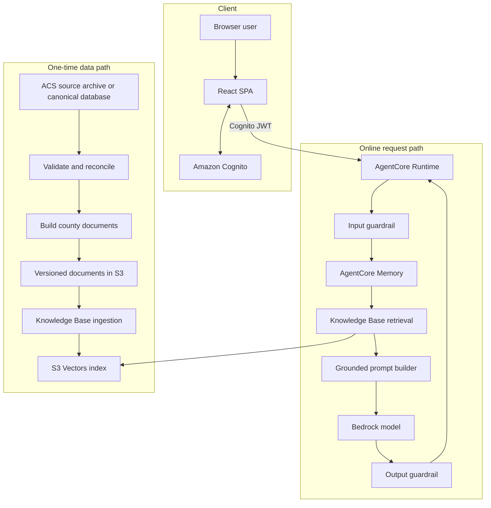
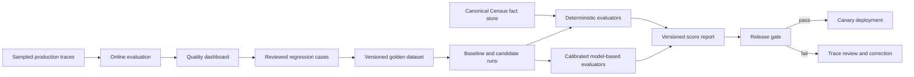
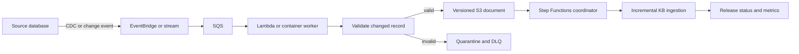

# Census Chat

**Census Chat is live:** https://d3pnyin1lmru98.cloudfront.net

| Demo credential | Value |
|---|---|
| Username | `test_census` |
| Password | `Census2024!` |

Census Chat is a retrieval-augmented AI assistant for exploring county-level US Census demographics. It answers from the 2020 American Community Survey (ACS) 5-year estimates, preserves conversation context, and validates inputs and outputs with Amazon Bedrock Guardrails.

## Design at a glance

| Concern | Design choice | Reason |
|---|---|---|
| Source data | Immutable ACS 2020 snapshot | The source does not change during normal chat traffic |
| Data preparation | One-time offline validation, transformation, and ingestion | Avoid repeated source queries, aggregation, and embedding work |
| Answering | Retrieval-augmented generation (RAG) | Give the model a small set of relevant Census passages |
| Runtime | Amazon Bedrock AgentCore Runtime | Host the agent and isolate sessions without a custom API tier |
| Authentication | Amazon Cognito JWT validated by AgentCore | Authenticate browser requests without API Gateway |
| Retrieval | Bedrock Knowledge Base backed by S3 Vectors | Store and search precomputed Census document embeddings |
| Memory | AgentCore short- and long-term memory, scoped by stable actor ID | Support follow-ups and user preferences across turns |
| Safety | Input guardrail, grounded prompt, output guardrail | Block unsafe requests and unsupported model output |

| Infrastructure | AWS CDK and CloudFormation | Make resources repeatable, reviewable, and stack-owned |
| Future freshness | Event-driven, incremental ingestion | Update only changed records if the source becomes dynamic |
| Future quality | Deterministic and model-based agent evaluation | Catch regressions that ordinary availability monitoring misses |

> **Implementation status:** The runtime query pipeline is implemented. Knowledge Base infrastructure ownership is still being migrated into CDK. `infra_scripts/create_kb.py` contains legacy provisioning logic, but `deploy.sh` does not call it and `DataStack` does not yet define every Knowledge Base resource. See [Infrastructure design and current gap](#infrastructure-design-and-current-gap).

### Scope

The current dataset supports:

- County-level population, age, sex, and race data
- Income and poverty measures
- Housing, homeownership, home value, and rent
- Employment and unemployment
- Educational attainment

The current design does not promise:

- Block-group or tract-level answers
- Live Census updates
- Time-series analysis across ACS releases
- State or national calculations that are absent from the canonical data
- Arbitrary aggregation by the language model

## System architecture



### Request lifecycle

A successful chat turn follows this path:

1. The user signs in through Cognito.
2. The browser sends the message and Cognito JWT directly to AgentCore Runtime.
3. AgentCore validates the token before invoking the application.
4. The application validates message size and actor/session identifiers.
5. The input guardrail checks topic and content policy. A guardrail-service failure fails closed.
6. Short-term memory loads recent turns. Long-term memory loads relevant actor-scoped context.
7. Recent user questions are added to the retrieval query so follow-ups retain geography and topic.
8. The Knowledge Base returns passages that meet the relevance threshold.
9. The prompt builder places those passages inside `<census_data>` and marks memory as non-authoritative.
10. The Bedrock model generates an answer from the retrieved evidence.
11. The output guardrail checks the answer against the user query and retrieved passages.
12. The accepted turn is saved to memory and returned to the browser.

The primary design does not use API Gateway. AgentCore handles the authenticated runtime endpoint.

## Key design decisions

### Use one-time ingestion for static data

The 2020 ACS data is an immutable statistical snapshot. It does not need to be downloaded, transformed, or embedded for every question. Census Chat therefore performs this work once, outside the request path:

```text
Source archive
    -> validate and aggregate
    -> create county documents
    -> upload versioned documents to S3
    -> run Knowledge Base ingestion
    -> reuse the vectors for every chat request
```

This saves time and cost because:

- Chat requests do not scan or aggregate raw Census tables.
- The application does not depend on the source database being online.
- Embeddings are generated once rather than once per request.
- Runtime latency consists mainly of retrieval, model generation, and safety checks.
- The same immutable release can be reproduced, tested, and audited.

Run ingestion again only when a new ACS release arrives, a source correction is published, or transformation logic changes.

### Use RAG instead of model-only answers

The model receives a small number of relevant Census passages rather than the entire dataset. This lowers prompt size and makes the evidence visible to grounding checks.

RAG does not make arbitrary calculations reliable. If a requested state total, national value, or multi-county aggregate is not present in the validated dataset, the agent should explain the limitation rather than estimate it.

### Use county documents as the retrieval unit

Approximately 3,200 county documents provide broad geographic coverage while keeping the index small. Tract or block-group documents would increase index size and retrieval ambiguity substantially. A future use case requiring that granularity should use separate metadata-filtered indexes or a structured query service.

### Separate memory from authoritative evidence

Short-term memory supports follow-up questions in one session. Long-term memory stores summaries and preferences across sessions. Neither memory tier is a valid source for Census numbers.

Only content inside `<census_data>` may support numeric claims. Memory may identify what geography the user means or how the user prefers an answer to be formatted.

## Identity and session management

### Two identifiers, two lifecycles

| Identifier | Source | Lifecycle | Purpose |
|---|---|---|---|
| `actor_id` | Cognito `sub` claim from the signed-in user | Permanent per user; identical on every login, device, and browser | Scopes all AgentCore Memory reads and writes to one user |
| `session_id` | UUID generated by the frontend when a conversation starts | Stable for the conversation's lifetime; new ID when the user clears the chat | Groups turns into one conversation thread |

```text
Cognito sign-in
    -> idToken.payload.sub  (actor_id, e.g. "a1b2c3-...-user-uuid")
        -> AgentCore Memory namespace: /actors/<actor_id>/...

New conversation
    -> uuidv4()             (session_id, e.g. "9f8e7d-...-conversation-uuid")
        -> AgentCore session: events keyed by (actor_id, session_id)
```

### Actor identity: stable across logins

The frontend reads `actor_id` from the Cognito ID token's `sub` claim (`frontend/src/lib/auth.ts`). Because Cognito assigns `sub` once per user, the same user always gets the same actor ID on every login and every device. Long-term memories, preferences, and session summaries therefore follow the user, not the browser.

The browser sends the actor ID in the request body, but production hardening should derive it from the validated JWT instead of trusting the payload (see [Security design](#security-design)).

### Session identity: stable within a conversation

The frontend creates a `session_id` with `uuidv4()` the first time `useChat` mounts and keeps it in a React ref (`frontend/src/hooks/useChat.ts`). Every turn sends it in the `X-Amzn-Bedrock-AgentCore-Runtime-Session-Id` header (`frontend/src/lib/agentcore.ts`). AgentCore uses that header to route the request to the same session-scoped microVM, and the backend stores short-term events under `(actor_id, session_id)` in AgentCore Memory.

Consequences of this model:

- All turns in one page load share one session ID, so follow-up questions retrieve the right history.
- Clearing the chat generates a new UUID, which intentionally starts a fresh conversation with no short-term history.
- A page refresh currently generates a new UUID. The previous conversation still exists in AgentCore Memory but is not reopened by the UI.
- Short-term events expire after the memory store's configured TTL, and long-term strategies keep durable context beyond that.

### Future: resumable conversations across devices

To let a user always return to the same conversation, persist the session ID instead of regenerating it on page load:

1. Persist `session_id` per user in `localStorage` (same-device resume) or in a session registry table keyed by `actor_id` (cross-device resume).
2. On sign-in, restore the user's most recent active session ID and hydrate the UI from `list_events` for that session.
3. Support multiple named conversations by storing a list of session IDs per actor and rendering a conversation picker, the same model used by ChatGPT-style history sidebars.
4. Only mint a new UUID when the user explicitly starts a new conversation.

This preserves the isolation guarantee: one user's sessions are always namespaced under their own stable `actor_id`, and AgentCore never mixes memory between actors.

## Infrastructure design and current gap

### Why use stack deployment

CDK definitions are converted by `cdk synth` into a CloudFormation template. `cdk deploy` asks CloudFormation to create or update the resources as one tracked stack.

Stack ownership provides:

- Explicit resource dependencies
- Repeatable deployments and reviewable change sets
- Resource IDs passed as CloudFormation tokens
- Drift detection and rollback
- Retention and deletion policies
- One owner for each resource and SSM parameter

A standalone `boto3` script issues sequential API calls, but CloudFormation does not track the resources it creates.

### Target stack ownership

#### `CensusChatDataStack`

The data stack should own:

- Private, versioned S3 bucket for source and generated documents
- S3 Vectors bucket and vector index
- Bedrock Knowledge Base and S3 data source
- Knowledge Base service role with least-privilege policies
- Bedrock Guardrail and version
- Required CloudFormation outputs or non-secret SSM parameters

```text
Document bucket ---------------------------> Bedrock data source
                                                  |
S3 Vectors bucket -> vector index -> Knowledge Base
                           ^              |
                           |              +------> AgentStack
Knowledge Base IAM role ---+
```

#### `CensusChatAgentStack`

The agent stack should own:

- Cognito user pool and browser client
- AgentCore Memory and its strategies
- Agent runtime execution role
- ECR image reference using an immutable tag or digest
- AgentCore Runtime and environment variables

The Knowledge Base ID must come directly from `DataStack`, not from a hard-coded fallback.

#### `CensusChatFrontendStack`

The frontend stack should own:

- Private S3 website bucket
- CloudFront distribution and origin access control
- SPA routing behavior
- Frontend deployment outputs

### Replace `create_kb.py` only after migration

`infra_scripts/create_kb.py` is legacy bridge code for resources that were previously difficult to express in CloudFormation. The target stack should replace it with:

- `AWS::S3Vectors::VectorBucket`
- `AWS::S3Vectors::Index`
- `AWS::Bedrock::KnowledgeBase`
- `AWS::Bedrock::DataSource`

Do not delete the script until the stack creates all four resources, exports the required IDs, and completes an ingestion test in a clean environment.

Resources that already exist outside CloudFormation must be imported or deliberately replaced. Reusing their names in CDK does not transfer ownership automatically. CDK, shell scripts, and `boto3` scripts must never overwrite the same resource or SSM parameter.

## Data integrity and hallucination controls

RAG lowers hallucination risk but does not prove that an answer is correct. Census Chat applies controls at ingestion, retrieval, generation, and response validation.

### Validate source data before ingestion

Validate every generated value against the canonical source database or an immutable structured export.

Required checks include:

- Schema and data types
- Unique and valid state/county FIPS codes
- Expected geography count and duplicate detection
- Census missing-value and suppression sentinels
- Percentages within 0 through 100
- Non-negative counts and currency values
- Valid denominators before calculating rates
- Reconciliation of component totals where supported
- Spot checks against known source queries
- Checksums for source rows and generated documents

Quarantine invalid records and prevent them from entering the Knowledge Base. Fail the ingestion release when validation exceeds the accepted error threshold.

### Preserve provenance and versioning

Each document should include:

- Dataset and release year
- ACS estimate type
- Geography, FIPS code, and geographic level
- Source table and field identifiers where available
- Transformation version and source checksum
- Ingestion timestamp

Store releases under versioned prefixes:

```text
s3://<data-bucket>/source/acs-2020/<checksum>/
s3://<data-bucket>/documents/acs-2020/<transform-version>/
```

A release manifest should record source checksums, validation results, document counts, ingestion-job ID, and activation status. Every answer citation should be traceable to this manifest.

### Retrieve conservatively

- Apply a minimum relevance score; do not use an unqualified low-score result.
- Filter by geography and dataset version when metadata is available.
- Ask for clarification when a place name is ambiguous.
- Return “data unavailable” when a metric or geographic level is absent.
- Do not derive state or national figures by averaging county percentages.
- Keep the retrieved set small enough to avoid unrelated evidence.

### Enforce prompt trust boundaries

- Treat retrieved documents, conversation history, memory, and tool output as untrusted data.
- Use explicit prompt sections and escape content that could close those sections.
- Treat only `<census_data>` as authoritative for numeric claims.
- Do not allow memory to supply Census values.
- Do not reveal system instructions or hidden context.

### Validate generated output

The output guardrail receives:

- Retrieved passages as `grounding_source`
- The question as `query`
- The proposed answer as `guard_content`

If grounding validation fails, return the guardrail message instead of the proposed answer.

A stronger future control is deterministic claim validation:

1. Ask the model for structured claims containing year, FIPS code, metric ID, value, unit, and citation.
2. Query the canonical database or validated fact store for every claim.
3. Compare values using metric-specific tolerances.
4. Reject unsupported claims or mismatched geography and year.
5. Regenerate once with validation feedback, or return “unable to verify.”
6. Return only the validated natural-language answer and citations.

The fact store can be a versioned Parquet dataset, DynamoDB table, or relational table generated from the same source release. It must remain independent of model output.

## Security design

Census data is public, but identities, user questions, and conversation memory may be sensitive.

### Authentication and isolation

- Validate Cognito JWTs at the AgentCore boundary.
- Derive `actor_id` from a validated JWT claim rather than trusting the request body.
- Scope memory access to the authenticated actor namespace.
- Reject malformed actor and session identifiers.
- Keep development, staging, and production user pools separate.
- Disable self-registration unless the product requires it.

### Least-privilege access

- Restrict the Knowledge Base role to its document prefix and vector index.
- Restrict the runtime role to required model, retrieval, guardrail, memory, and logging actions.
- Avoid wildcard resources when AWS supports resource-level permissions.
- Separate deployment roles from runtime roles.
- Apply permission boundaries or organization policies in production.

### Data and secret protection

- Block public access to data and frontend-origin S3 buckets.
- Use CloudFront origin access control for the SPA bucket.
- Encrypt S3, S3 Vectors, memory, and logs at rest.
- Use TLS for every service call.
- Store secrets in Secrets Manager and non-secret identifiers in stack outputs or SSM.
- Never commit passwords, tokens, access keys, or shared demo credentials.
- Resolve account and resource IDs from CDK rather than hard-coding them.
- Define explicit retention periods for logs and memory.

### Application protection

- Fail closed when a required guardrail cannot run.
- Limit input length, retrieval count, prompt size, and output size.
- Rate-limit by authenticated actor.
- Do not return raw internal exceptions or infrastructure details.
- Log pseudonymous identifiers rather than complete user prompts.
- Scan and pin container and Python dependencies.

## Capacity and reliability

### Data capacity

Let:

- `D` = county document count, currently about 3,200
- `C` = measured average chunks per document
- `V = D × C` = total vector count
- `E = 1,024` = embedding dimensions

For 32-bit floating-point embeddings:

```text
raw vector bytes = V × E × 4
```

If each county produces two chunks, the raw embedding values are about 25 MiB before metadata, index overhead, and service replication. Use completed ingestion statistics for actual capacity and cost planning.

### Request amplification

One successful turn can make:

- Two guardrail calls
- One short-term memory read
- One long-term retrieval per active strategy
- One Knowledge Base retrieval
- One model invocation
- One short-term memory write

For chat rate `R`, guardrail demand is approximately `2R`; long-term memory demand is approximately `R × active_strategy_count`.

Monitor quotas for model requests and tokens, AgentCore concurrency, Knowledge Base retrievals, memory operations, guardrail transactions, ingestion jobs, and S3 Vectors throughput.

### Latency and caching

Measure p50, p95, and p99 latency for every pipeline stage. Model generation will usually dominate, but memory and two guardrail calls add fixed overhead.

The static dataset allows retrieval caching:

- Key caches by normalized query, geography filter, dataset version, and retrieval settings.
- Invalidate caches when a dataset version becomes active.
- Do not share generated-response caches when user memory affects the prompt.
- Do not cache authorization decisions beyond their safe lifetime.

### Failure behavior

| Failure | Response |
|---|---|
| Input guardrail unavailable | Fail closed and ask the user to retry |
| Input blocked | Return the policy message without retrieval or model invocation |
| Short-term memory unavailable | Continue without history and alert operators |
| Long-term memory unavailable | Continue without personalization and alert operators |
| Knowledge Base unavailable | Return a degraded response; do not ask the model to invent data |
| No qualified results | State that no sufficiently relevant data was found |
| Model failure or empty response | Return a degraded response without internal details |
| Output guardrail unavailable | Fail closed; do not return unchecked output |
| Output grounding blocked | Return the guardrail message |
| Memory write unavailable | Return the validated answer and record the failed write |
| Ingestion validation fails | Keep the previous dataset active and quarantine the release |

Use bounded exponential-backoff retries for transient errors. Do not retry policy denials or invalid requests.

## Agent observability

Operational monitoring and answer-quality monitoring are separate concerns. A request can return HTTP success while producing a wrong or unsupported answer.

### Trace model

Use one OpenTelemetry root span per chat turn and propagate its trace and session identifiers across AgentCore, Guardrails, Memory, Knowledge Base, and Bedrock calls.

```text
census_chat.turn
├── guardrail.input
├── memory.short_term.read
├── memory.long_term.retrieve       (one span per strategy)
├── knowledge_base.retrieve
├── prompt.build
├── model.invoke
├── guardrail.output
├── claim.validate                  (future)
└── memory.short_term.write
```

Record:

- Request, trace, and pseudonymous actor/session identifiers
- Model, prompt, retrieval, and dataset versions
- Outcome, error category, latency, retry, and throttle status
- Token counts and estimated cost
- Retrieval count, score distribution, and cited document IDs
- Memory strategy and record count
- Guardrail outcome
- Claim-validation result when available

Do not put JWTs, credentials, full prompts, raw memory, or full user questions in span attributes. Detailed content capture requires sampling, redaction, restricted access, and short retention.

### AgentCore and CloudWatch

The production setup should:

1. Enable CloudWatch Transaction Search for the account and Region.
2. Enable tracing when AgentCore Memory is created.
3. Add AWS Distro for OpenTelemetry instrumentation to the agent image.
4. Configure Strands to emit model and orchestration spans.
5. Send traces and structured logs to a dedicated encrypted log group.
6. Correlate application and AgentCore spans with trace and session IDs.
7. Retain all errors and degraded traces while sampling ordinary successes.

### Metrics and alerts

| Area | Indicators |
|---|---|
| Availability | Successful, blocked, degraded, and failed turns |
| Latency | End-to-end and per-stage p50, p95, and p99 |
| Retrieval | Qualified-result rate, no-result rate, and score distribution |
| Generation | Token use, empty responses, failures, and response length |
| Grounding | Guardrail interventions, citation coverage, claim-validation rate |
| Memory | Read/write success and namespace failures |
| Freshness | Active dataset version, ingestion age, and update lag |
| Cost | Cost per turn and per validated answer |

Dashboards should show these metrics by model, prompt, retrieval configuration, dataset, and runtime version. Alerts should distinguish application failures from expected policy blocks and expected no-data responses. Every actionable alert needs an owner and runbook.

## Future agent evaluation

Evaluation should become a release gate for changes to prompts, models, retrieval, memory, guardrails, and datasets.

### Evaluation architecture



### Evaluation dataset and metrics

Use a versioned, human-reviewed dataset covering:

- Exact county lookups and county comparisons
- Follow-ups that require session history
- Ambiguous and duplicate place names
- Unsupported metrics, years, and geographic levels
- Required refusal and clarification cases
- Prompt injection and data-exfiltration attempts
- Irrelevant or low-score retrieval results
- Memory continuity and cross-actor isolation
- Dependency failure paths
- Old and newly activated data releases

Ground truth must come from the canonical database or validated fact store, not from another unverified model.

Use deterministic checks for:

- Numeric value and allowed tolerance
- Geography, FIPS code, unit, and ACS year
- Citation-to-claim consistency
- Retrieval recall@k and ranking
- Unsupported claims
- Refusal and clarification behavior
- Cross-actor memory leakage
- Safety-policy compliance
- Latency, token use, and cost

Use calibrated model-based evaluators for faithfulness, relevance, completeness, clarity, comparison quality, and communication of uncertainty. Version the evaluator prompt and model, compare it with human judgments, and do not let an uncalibrated model certify its own output.

### Evaluation stages

1. **Pull request:** Run deterministic checks and a small golden subset.
2. **Pre-deployment:** Compare the full candidate against the current production baseline.
3. **Canary or shadow:** Test a controlled traffic sample and retain rollback capability.
4. **Online:** Evaluate privacy-filtered production traces and monitor quality trends.
5. **On demand:** Investigate customer reports and low-scoring trace IDs.

AgentCore Evaluations can support on-demand, batch, and sampled online evaluation. Census value checks should remain deterministic or code-based; qualitative criteria may use built-in or custom evaluators.

### Release gates and feedback loop

A release must have:

- No known cross-actor memory disclosure
- No unsupported numeric claims in mandatory cases
- No safety or prompt-injection regression
- Correct year and geography in deterministic cases
- Citation and retrieval scores at or above the approved baseline
- Latency and cost within the accepted regression budget
- Human approval for material behavior or policy changes

Store the evaluation report as a build artifact. Link the deployed runtime to its code commit, model, prompt, retrieval configuration, dataset manifest, and evaluation report.

Confirmed production failures should be anonymized, validated against the canonical source, added to the regression dataset, and retested before the next canary. Evaluation detects regressions; it does not replace runtime grounding and source validation.

## Future near-real-time updates

One-time ingestion is appropriate for the current static release. If the source begins changing frequently, use an event-driven update path:



The update system should:

- Consume database CDC, domain events, or S3 object events.
- Buffer bursts and failures in SQS with a dead-letter queue.
- Use `dataset_version + geography_fips + source_checksum` as an idempotency key.
- Rebuild only affected geography documents.
- Remove stale vectors with explicit deletion or tombstone handling.
- Batch events because Knowledge Base ingestion is asynchronous.
- Keep the previous release active until the new release passes validation.
- Activate a completed version atomically and invalidate retrieval caches.
- Measure source-to-searchable update lag.

This provides near-real-time, eventual consistency. If users need transaction-level freshness or exact aggregation over rapidly changing facts, query a structured database tool at runtime and use the Knowledge Base only for definitions and narrative context.

---

## Setup and deployment

### Prerequisites

- Python 3.11+
- AWS CLI with an authorized deployment profile
- Docker
- Node.js 18+
- AWS CDK CLI
- `jq`
- Access to the required Bedrock models and AgentCore services

The shared demo credentials at the top of this file exist only for the public demo. Production deployments should create per-user accounts and keep credentials out of the repository.

### Local data preparation

The ETL process is offline by design:

```bash
cd etl
pip install -r requirements.txt
python3 transform.py
python3 upload_to_s3.py <bucket-name>
python3 sync_kb.py
```

Do not run raw-data transformation during a chat request.

### Target AWS deployment order

1. Bootstrap CDK for the target account and Region.
2. Deploy `CensusChatDataStack`.
3. Validate and transform the source release.
4. Upload documents and complete Knowledge Base ingestion.
5. Build and push the exact agent image referenced by CDK.
6. Deploy `CensusChatAgentStack`.
7. Build the frontend with stack outputs.
8. Deploy `CensusChatFrontendStack` and invalidate CloudFront.
9. Run deployment smoke tests.

The current `deploy.sh` should not be treated as clean-account automation until the Knowledge Base resources and outputs move into `DataStack` and duplicate script ownership is removed.

## Testing

Install the test dependencies and run the suite:

```bash
cd tests
pip install -r requirements.txt
pytest -v
```

Current tests mock external AWS services. Production readiness also requires:

- Contract tests against a small deployed Knowledge Base
- AgentCore Runtime and Memory integration tests
- Guardrail grounding tests
- Strict actor-memory isolation tests
- Ingestion and rollback tests
- Browser tests for sign-in and chat
- The agent evaluation gates described above

## Example questions

- “What is the median household income in Cook County, Illinois?”
- “Compare poverty rates between two named counties.”
- “What percentage of Travis County, Texas has a bachelor's degree?”
- “What is the homeownership rate in Erie County, Pennsylvania?”
- “Which of these explicitly named counties has the oldest median age?”

Questions requiring an unavailable national statistic, state aggregate, year, or geographic level should return a clear limitation rather than an estimate.

## AWS references

- [AWS CloudFormation: Bedrock Knowledge Base](https://docs.aws.amazon.com/AWSCloudFormation/latest/TemplateReference/aws-resource-bedrock-knowledgebase.html)
- [AWS CloudFormation: S3 Vectors configuration for a Knowledge Base](https://docs.aws.amazon.com/AWSCloudFormation/latest/TemplateReference/aws-properties-bedrock-knowledgebase-s3vectorsconfiguration.html)
- [AWS CloudFormation: S3 Vectors vector bucket](https://docs.aws.amazon.com/AWSCloudFormation/latest/TemplateReference/aws-resource-s3vectors-vectorbucket.html)
- [AWS CloudFormation: S3 Vectors index](https://docs.aws.amazon.com/AWSCloudFormation/latest/TemplateReference/aws-resource-s3vectors-index.html)
- [AgentCore Memory SDK guide](https://docs.aws.amazon.com/bedrock-agentcore/latest/devguide/aws-sdk-memory.html)
- [AgentCore Observability](https://docs.aws.amazon.com/bedrock-agentcore/latest/devguide/observability.html)
- [Configure AgentCore observability](https://docs.aws.amazon.com/bedrock-agentcore/latest/devguide/observability-configure.html)
- [AgentCore evaluation types](https://docs.aws.amazon.com/bedrock-agentcore/latest/devguide/evaluations-types.html)
- [AgentCore evaluators](https://docs.aws.amazon.com/bedrock-agentcore/latest/devguide/evaluators.html)

AWS service descriptions in this document were rephrased for compliance with licensing restrictions.
